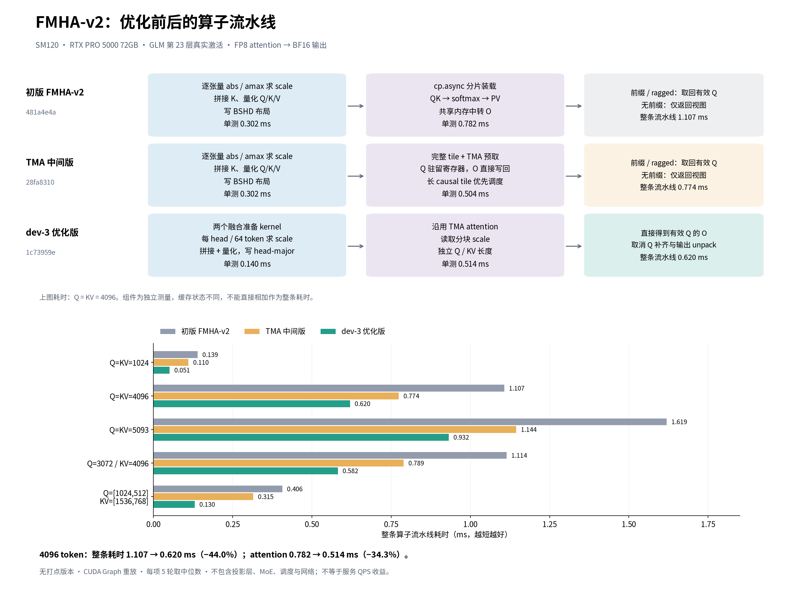
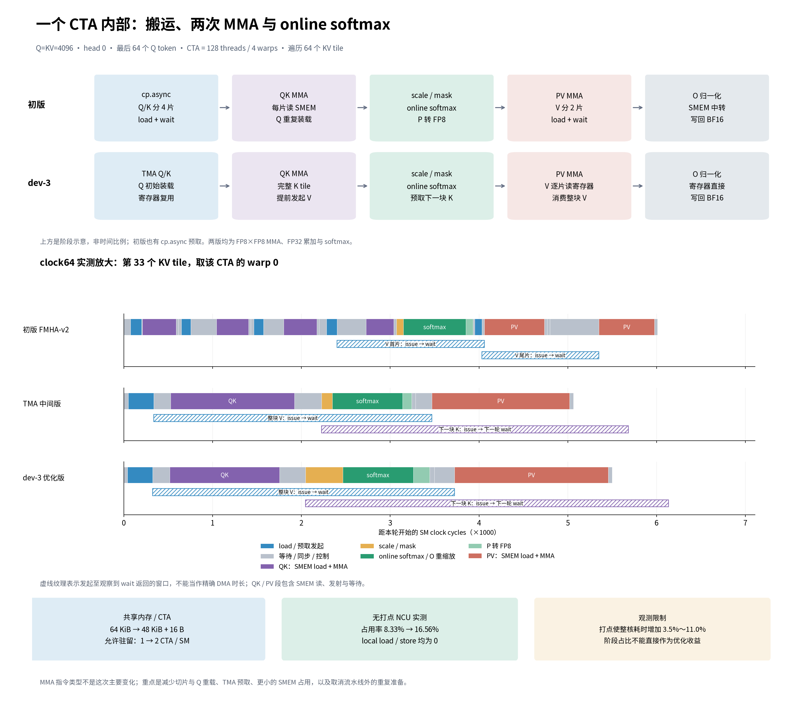
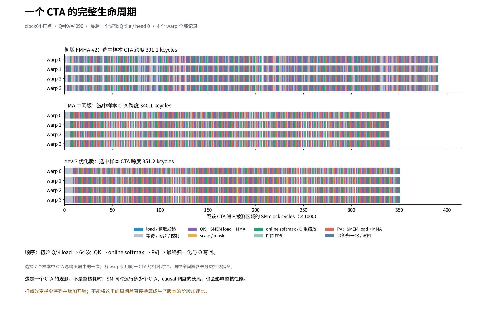

# FMHA-v2 优化前后：算子流水线与 CTA 打点

本次只运行算子。4096 token 样例中，初版到 dev-3 的整条算子流水线从 **1.107 ms 降到 0.620 ms，耗时下降 44.0%（1.79×）**；attention 单独耗时从 **0.782 ms 降到 0.514 ms，下降 34.3%**。主要收益来自数据准备融合、完整 tile / Q 复用、TMA 预取、降低共享内存占用以及调度；不是 online softmax 或 MMA 指令本身加速了 44%。

这里“优化前”指最初 FMHA-v2，不是之前的另一套原融合 FP8 内核。本次未重新测原融合 FP8，也未进行服务 QPS 压测。

**[逐项优化说明：原来怎么做、为什么没做、修改代码与收益证据](./OPTIMIZATION_DETAILS.md)**

**图与源数据**

- 整个算子流水线与无打点耗时：[pipeline-overview.png](./pipeline-overview.png) · [pipeline-overview.svg](./pipeline-overview.svg) · [可编辑 draw.io](./pipeline-overview.drawio)
- CTA 阶段示意与单轮 KV 实测放大：[cta-pipeline.png](./cta-pipeline.png) · [cta-pipeline.svg](./cta-pipeline.svg) · [可编辑 draw.io](./cta-pipeline.drawio)
- 同一 CTA 的全部 4 个 warp、64 轮 KV 和写回：[cta-full-timeline.png](./cta-full-timeline.png) · [矢量图下载（SVG gzip）](./cta-full-timeline.svg.gz) · [可编辑 draw.io](./cta-full-timeline.drawio)

**[下载三页合一的 draw.io 文件](./fmha-v2-pipeline-all.drawio)**：在 GitHub 文件页选择 Download raw file，随后在 [diagrams.net](https://app.diagrams.net/) 中选择“文件 → 从设备打开”，也可用 draw.io 桌面版打开。底部标签切换三页。

draw.io 版从同一份测量数据重建，文字、方框、箭头、柱形和时间条均为原生可编辑对象。完整 CTA 时间线按版本分层、按 warp 分组；进入分组后可以选择单个阶段，悬停或右键“编辑数据”可查看其版本、warp、step、起止周期和持续周期。异步窗口用虚线框表示。为了适合编辑，布局重新排版，数值与样本选择保持一致。手动拉伸时间条或修改标签不会自动重算数据；原始测量仍以 JSON 为准。

**比较版本**

| 版本 | FlashInfer commit | 内容 |
|---|---|---|
| 初版 | `481a4e4a` | cp.async，QK 深度分 4 片、PV 分 2 片，O 经共享内存中转 |
| TMA 中间版 | `28fa8310` | 完整 tile、直接输出、TMA、causal 调度；仍用旧准备与 Q 补齐 |
| dev-3 | `1c73959e` | 沿用 TMA；接入分块 scale / packed head-major，Q 与 KV 独立长度 |

TMA 中间版是已经优化 attention 内核、仍保留旧准备流程的历史对照版本。它用于拆开两组变化：初版→中间版观察完整 tile、Q 复用、TMA 预取、直接输出和 CTA 调度的合计效果；中间版→dev-3 观察融合准备、布局、分块 scale 和独立 Q/KV 长度的合计效果。它不是 dev-3 运行时额外经过的一层，也不是“只打开 TMA”这一项的消融实验。

以 Q=KV=4096 为例，中间版 attention 为 0.503777 ms，dev-3 为 0.513957 ms，后者略慢 2.02%；但整条流水线从 0.773923 ms 降至 0.619992 ms，下降 19.89%。这说明该样例中 dev-3 的额外收益主要在数据准备流程，不能只看 attention 内核判断整体速度。

三版使用相同原始输入。初版与中间版使用相同逐张量 FP8 量化；dev-3 改用每 head、每 64 token 的量化，因此它与初版并非逐 bit 相同的数值路径。

**无打点整条流水线实测**

| Q / KV token | 初版(ms) | TMA 中间版(ms) | dev-3(ms) | 初版→dev-3 耗时下降 | 中间版→dev-3 耗时下降 |
|---|---:|---:|---:|---:|---:|
| [1024] / [1024] | 0.139390 | 0.110180 | 0.050847 | 63.52% | 53.85% |
| [4096] / [4096] | 1.106703 | 0.773923 | 0.619992 | 43.98% | 19.89% |
| [5093] / [5093] | 1.619387 | 1.144499 | 0.931521 | 42.48% | 18.61% |
| [3072] / [4096] | 1.114276 | 0.789462 | 0.581807 | 47.79% | 26.30% |
| [1024, 512] / [1536, 768] | 0.406382 | 0.314702 | 0.130002 | 68.01% | 58.69% |

4096 token 的准备阶段单测：0.302220 → 0.139794 ms，下降 **53.74%**。这组无前缀输入无需输出 unpack；所以该收益不能归因于“去掉前缀补齐”。前缀、ragged 场景还额外减少补齐 Q 的计算与输出拷贝。

组件是独立 CUDA Graph 测量，缓存与执行上下文不同，不能将准备、attention、unpack 的单测数值直接相加或据此分摊总收益。1.79×是算子流水线的速度比，不是服务 QPS 提升。

**一个 CTA 到底做什么**

一个 CTA 处理一个 head 的 64 个 Q token，共 128 threads / 4 warps。对每块 64-token KV，执行 `QK MMA → scale/mask → online softmax → P 转 FP8 → PV MMA`，最后归一化并写回 O。online softmax 会维护跨 KV 块的最大值与指数和，并重缩放此前累积的 O。QK 和 PV 都使用 FP8×FP8 Tensor Core MMA、FP32 累加；softmax 主要是 FP32 的归约、指数等操作。

- 初版：已经使用 cp.async 预取，但 Q/K 按 4 个深度切片加载、计算，PV 分 2 片，切片间存在等待和同步，Q 也重复装载。
- 优化版：TMA 初始搬入完整 Q/K；Q 加载到寄存器后跨 KV 轮次复用。计算 QK 前发起当前 V 的 TMA；读完 K 并同步后发起下一块 K，让它与 softmax、PV 等工作形成重叠窗口。V 按 fragment 读取以控制寄存器使用。
- O 直接从累加器转换并写全局内存，取消共享内存输出中转；主要价值还在于降低整 CTA 共享内存资源预算。
- causal 调度把较长的 Q tile 提前并分散到不同 head，减少末尾仅少量 SM 有活的情况。这不体现在一个 CTA 内部阶段的简单求和里。
- dev-3 的两个准备 kernel 分别量化 Q、融合 K 拼接与 K/V 量化；scale 的 amax 在这些准备 kernel 中计算。attention 读取 scale 并参与缩放，不在内部重新扫描原始 Q/K/V 求 amax。

上述四类内核修改在本次初版→中间版对比中整体测量，未为 full-tile、直接输出、TMA、调度各自单独给出收益百分比。中间版→dev-3 在 4096 token 下 attention 0.503777 → 0.513957 ms 略增约 2.0%，整条流水线仍缩短 19.9%；该段收益主要来自准备流程。

**NCU 资源证据：同一 4096-token attention，生产编译版本**

| 指标 | 初版 | TMA 中间版 | dev-3 |
|---|---:|---:|---:|
| 寄存器 / thread | 229 | 251 | 252 |
| 动态共享内存 / CTA (byte) | 65,536 | 49,168 | 49,168 |
| 共享内存允许的 CTA / SM | 1 | 2 | 2 |
| 寄存器允许的 CTA / SM | 2 | 2 | 2 |
| 实测 active warp 占用率 (%) | 8.33 | 16.56 | 16.56 |
| local load sectors | 0 | 0 | 0 |
| local store sectors | 0 | 0 | 0 |
| shared load bank conflicts | 3,236 | 21,420,226 | 21,399,718 |

64 KiB → 48 KiB + 16 B，使共享内存允许的驻留数由 1 变成 2；占用率从 8.33% 提升至 16.56%。两版均未观察到 local-memory 读写，因此本次没有“消除了原版寄存器溢出”的证据。dev-3 寄存器使用反而更高。优化版仍有明显 shared-memory bank conflict，不能声称已消除共享内存瓶颈；该计数也不能直接换算成整体延迟损失。

**打点口径与开销**

在三个隔离 worktree 中增加 `clock64` 打点：仅记录 batch 0 / head 0 / 最后一个逻辑 Q tile，4 个 warp 各取 lane 0；没有增加 CTA barrier。每例采集 7 次，图中选总 CTA 跨度居中的一次。dense4096 和 prefix 都记录完成。

| 版本（dense4096） | 无打点(ms) | 打点编译但关闭(ms) | 开启记录(ms) | 整核观测开销 |
|---|---:|---:|---:|---:|
| baseline | 0.768515 | 0.851659 | 0.853075 | 11.00% |
| tma_padded | 0.490385 | 0.513056 | 0.515336 | 5.09% |
| dev3 | 0.502553 | 0.519253 | 0.520041 | 3.48% |

打点编译也会改变优化与寄存器分配；记录版寄存器数为 230 / 255 / 255，同样未观察到 local load/store。全核开销不等于选中 CTA 的局部开销。主性能表只使用无打点版本。

图的横轴是 SM clock cycles，不按名义 GPU 频率强行换算微秒。QK/PV 色块包括 shared-memory load、指令发射、依赖等待以及打点开销，并非 Tensor Core 的纯忙碌时间。异步窗口是 issue 到 wait 返回的范围，不是 DMA 实际完成时间。单 CTA、单轮的柱长不能当作生产阶段加速比，也不能用于直接解释整核全部收益。

**正确性与测试范围**

- 五组形状中，初版与中间版输出逐 bit 一致；六组 trace 运行与各自无打点版本逐 bit 一致。
- 对 4096-token 单层 BF16 SDPA 参考，输出均有限。相对 L2：baseline 6.044%；tma_padded 6.044%；dev3 6.240%。这反映该层 FP8 路径及量化方式的数值差异，不能等同于模型准确率变化。
- 输入来自已保存的第 23 层实际激活；包含 BF16 Q、展开后的 K_nope/K_rope/V，不包含 KV cache 读取、kv_b_proj、o_proj、MoE、调度或网络。
- 测量为预热后的 CUDA Graph 重放：每项 5 轮交替顺序，每轮约 50 ms，取中位数；不是首次 JIT、冷 GPU 缓存或请求级压测。

**测量附件与复现依赖**

测量程序：[measure.py](./measure.py)；画图程序：[visualize.py](./visualize.py)；打点生成器（应用于干净隔离 worktree）：[instrument.py](./instrument.py)。

完整打点补丁含新 header：[trace-baseline.patch](./trace-baseline.patch)、[trace-tma_padded.patch](./trace-tma_padded.patch)、[trace-dev3.patch](./trace-dev3.patch)。已通过反向应用检查；补丁仅用于隔离的诊断编译，不自动应用到生产内核。

原始数据：[latency.json](./latency.json)、[trace-summary.json](./trace-summary.json)、[ncu-summary.json](./ncu-summary.json)、[accuracy.json](./accuracy.json)；完整 trace 以 `trace-*-*.json.gz` 保存。NCU 汇总在本目录，原始 NCU profiler 会话留在测量机器上。

测量和打点脚本保留本次实验结构，依赖隔离的三个源码 worktree、编译产物路径（`libraries.json`）、SGLang 的新旧适配器、`materialized_fp8_quantize` 和本地第 23 层激活文件。这些外部运行依赖与激活数据未随文档上传；脚本不是任意机器上直接重跑的独立测试。

`visualize.py` 可从本目录压缩后的 trace 与汇总 JSON 重画图，无需 GPU。中文字体使用已安装的 Noto Sans CJK SC / Noto Sans SC，或通过 `FMHA_PIPELINE_FONT` 指定字体文件；本目录不附带字体。报告中的 PNG 可直接在 GitHub 查看，SVG 可下载。

[export_drawio.py](./export_drawio.py) 复用 `visualize.py` 的数据和 trace 分段逻辑，生成三个独立 `.drawio` 文件及三页合一文件，无需 GPU。使用 draw.io 标准压缩 XML 保存；解压后为原生 mxGraph 图元，未嵌入 PNG/SVG 图片。编辑器使用本机中文字体显示文本。
